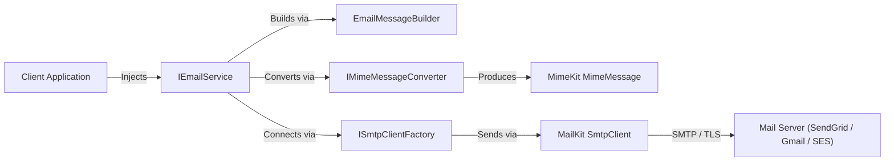

# Introduction

**AmtStudio.CustomMailingKit** is a production-grade, highly testable, and reusable email library built on top of **MailKit 5** and **MimeKit 5** for modern .NET applications (.NET 10+).

## Why AmtStudio.CustomMailingKit?

While MailKit is the premier email protocol library for .NET, building enterprise email workflows often requires boilerplate code:
- Wiring up connection options with `IConfiguration` and `Microsoft.Extensions.Options`.
- Implementing exponential backoff retry policies for flaky network blips.
- Converting complex attachment logic (streams, raw bytes, inline CID resources).
- Setting up clean test mocks without dealing with low-level socket clients.

`AmtStudio.CustomMailingKit` solves all of these by providing a clean, fluent abstraction layer while maintaining full fidelity with MailKit.

---

## Architecture at a Glance

---

## Feature Matrix

| Feature | Support |
| :--- | :---: |
| .NET 10 & C# 13+ | ✅ |
| `Microsoft.Extensions.DependencyInjection` | ✅ |
| `IConfiguration` / `appsettings.json` binding | ✅ |
| Fluent Builder API (`EmailMessageBuilder`) | ✅ |
| HTML & Plain text dual bodies | ✅ |
| File, byte[], and stream attachments | ✅ |
| Inline Linked Resources (``) | ✅ |
| Custom Headers & Priority flags | ✅ |
| Resilient transient retries (exponential backoff) | ✅ |
| Built-in token engine (`{{ Property }}`) | ✅ |
| Client-side RazorLight rendering compatibility | ✅ |
| Fully Unit Tested (20/20 Passing) | ✅ |

---

## Next Steps

- Head over to [Getting Started](getting-started.md) to install and configure the package.
- Check [RazorLight Template Guide](razorlight-guide.md) to send dynamic HTML emails.
