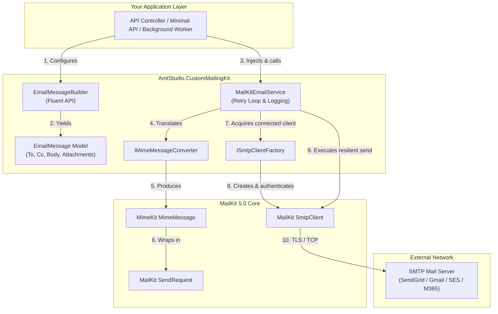

# Overview & Architecture

**AmtStudio.CustomMailingKit** is a production-grade, highly testable email delivery framework for **.NET 10+** applications. It builds directly upon the official **MailKit 5** and **MimeKit 5** libraries, delivering an enterprise-ready developer experience out of the box.

---

## ⚖️ Why Use AmtStudio.CustomMailingKit?

| Capability | Legacy `System.Net.Mail` | Raw `MailKit` | **AmtStudio.CustomMailingKit** |
| :--- | :---: | :---: | :---: |
| **Status** | ⚠️ *Deprecated by Microsoft* | Active OSS | ✅ Active & Maintained |
| **Modern Auth (TLS 1.3 / STARTTLS)** | ❌ Limited | ✅ Yes | ✅ Yes |
| **Native ASP.NET Core DI Registration** | ❌ No | ❌ Manual boilerplate | ✅ Built-in (`AddCustomMailingKit`) |
| **Transient Retry Policy** | ❌ No | ❌ Manual loop required | ✅ Built-in Exponential Backoff |
| **Fluent Message Builder** | ❌ No | ❌ Manual MimeMessage setup | ✅ Complete Fluent API |
| **Inline Images & Embedded CID** | ⚠️ Complex | ⚠️ Verbose | ✅ 1-Line (`AttachInline`) |
| **Client Template Compatibility** | ❌ None | ❌ None | ✅ RazorLight & Token Engine |
| **Mockable for Unit Testing** | ❌ Impossible | ⚠️ Hard (Needs sockets) | ✅ Full Interface Abstractions |

---

## 📐 Architecture Flow

The library cleanly separates domain models, builder contracts, MimeKit message translation, and transport socket lifecycles:



---

## ⚡ 10-Second Teaser

```csharp
// 1. Inject IEmailService into your class
public class OrderService(IEmailService emailService)
{
    public async Task CompleteOrderAsync(string customerEmail, byte[] pdfInvoice)
    {
        // 2. Build and deliver with fluent chaining & retries
        var result = await emailService.SendAsync(builder => builder
            .To(customerEmail)
            .Subject("Your Order Confirmation")
            .HtmlBody("<h1>Thank You!</h1><p>Your invoice is attached.</p>")
            .AttachBytes(pdfInvoice, "Invoice.pdf", "application/pdf")
            .Priority(EmailPriority.High));

        if (!result.IsSuccess)
        {
            // Log failure details without unhandled socket crashes
            Console.WriteLine($"Failed to send: {result.ErrorMessage}");
        }
    }
}
```

---

## 🧭 Navigation

- Jump straight into [Quick Start](getting-started.md) to set up your project in 2 minutes.
- Check out the [Configuration Guide](configuration.md) to bind `appsettings.json`.
- Learn how to send rich Razor templates in the [RazorLight Guide](razorlight-guide.md).
