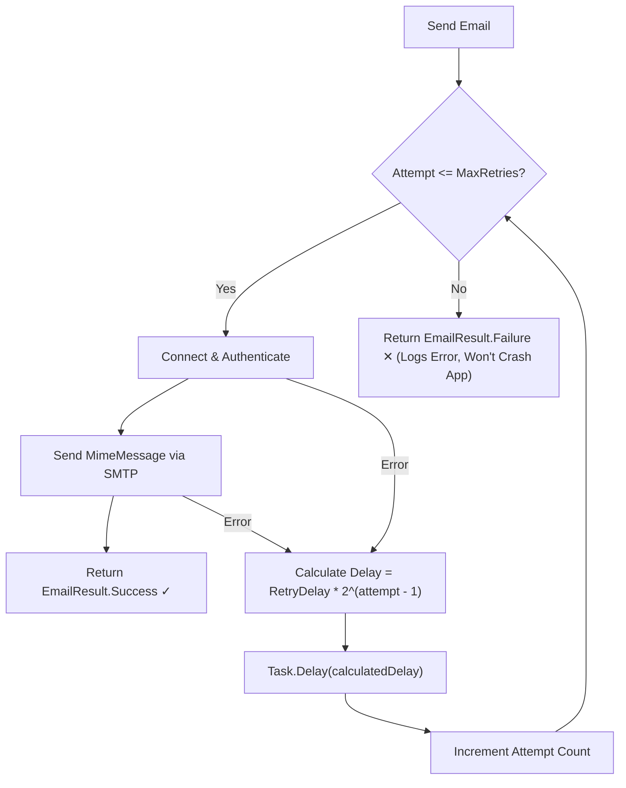

# Configuration & Options

The configuration model `SmtpOptions` governs how `AmtStudio.CustomMailingKit` connects to the mail host, manages TLS/SSL, handles credentials, and retries on failure.

---

## ⚙️ Configuration Properties

| Property | Type | Default | Required? | Description |
| :--- | :--- | :--- | :---: | :--- |
| `Host` | `string` | `""` | **Yes** | The hostname or IP address of the SMTP server (e.g. `smtp.gmail.com`). |
| `Port` | `int` | `587` | No | Port number. Standard ports: `587` (STARTTLS), `465` (SSL), `25` (Plain). |
| `SecurityMode` | `SmtpSecurityMode` | `Auto` | No | Connection security policy (see details below). |
| `UserName` | `string?` | `null` | Optional | Username or API key for authentication. If omitted, anonymous SMTP is used. |
| `Password` | `string?` | `null` | Optional | Password or secret token for authentication. |
| `DefaultFromAddress` | `string?` | `null` | Optional | Default sender email address used when `.From()` is omitted on a message. |
| `DefaultFromName` | `string?` | `null` | Optional | Default sender display name used with `DefaultFromAddress`. |
| `TimeoutMilliseconds`| `int` | `15000` | No | Socket connection and read/write timeout in milliseconds. |
| `MaxRetryAttempts` | `int` | `3` | No | Number of retry attempts before reporting failure. |
| `RetryDelayMilliseconds` | `int` | `1000` | No | Base delay between retries for exponential backoff. |
| `AllowInvalidCertificates` | `bool` | `false` | No | Bypasses certificate checks. **Use only for local development!** |

---

## 🔒 Security Modes (`SmtpSecurityMode`)

```csharp
public enum SmtpSecurityMode
{
    Auto = 0,                  // Auto-determines security: 465 uses SSL, other ports try STARTTLS
    SslOnConnect = 1,          // Direct SSL/TLS handshake immediately upon connection (Port 465)
    StartTls = 2,              // Connects in clear text then upgrades via STARTTLS command (Port 587)
    StartTlsWhenAvailable = 3, // Opportunistic STARTTLS (falls back to clear text if unsupported)
    None = 4                   // Plain unencrypted (for local test servers like MailHog or Papercut)
}
```

> [!WARNING]
> Never set `AllowInvalidCertificates = true` in production environments. It is intended solely for local development with self-signed test certificates.

---

## 🔁 Resilient Retry Policy

Network hiccups, intermittent DNS timeouts, or temporary rate limits can cause mail delivery to fail intermittently. 

`AmtStudio.CustomMailingKit` has an automated retry mechanism built into `IEmailService`:



### Retry Delay Progression Example (Base: 1000ms):
* **Attempt 1**: Sent immediately.
* **Attempt 2**: Waits $1000 \text{ ms} \times 2^0 = 1,000 \text{ ms}$ (1 sec).
* **Attempt 3**: Waits $1000 \text{ ms} \times 2^1 = 2,000 \text{ ms}$ (2 sec).
* **Attempt 4**: Waits $1000 \text{ ms} \times 2^2 = 4,000 \text{ ms}$ (4 sec).

If delivery still fails after all attempts, `IEmailService` returns an `EmailResult` containing the exception details and attempt count without throwing an unhandled exception.
