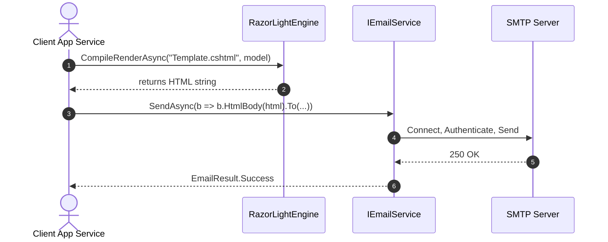

# RazorLight Template Guide

This guide details how to render dynamic `.cshtml` email templates using **RazorLight** in your client application and deliver them with `AmtStudio.CustomMailingKit`.

---

## Architecture Flow



---

## 1. Setup in Client Application

### Add NuGet Packages
```bash
dotnet add package RazorLight
dotnet add package AmtStudio.CustomMailingKit
```

### Configure DI (`Program.cs`)
```csharp
using System.IO;
using AmtStudio.CustomMailingKit.Extensions;
using RazorLight;

var builder = WebApplication.CreateBuilder(args);

// Register AmtStudio.CustomMailingKit
builder.Services.AddCustomMailingKit(builder.Configuration);

// Register RazorLightEngine pointing to the EmailTemplates folder
var templatesFolder = Path.Combine(builder.Environment.ContentRootPath, "EmailTemplates");
var razorEngine = new RazorLightEngineBuilder()
    .UseFileSystemProject(templatesFolder)
    .UseMemoryCachingProvider()
    .Build();

builder.Services.AddSingleton<IRazorLightEngine>(razorEngine);
```

---

## 2. Create the Model and Razor View

### `Models/OrderEmailModel.cs`
```csharp
namespace MyApp.Models;

public record OrderEmailModel(
    string OrderId,
    string CustomerName,
    string CustomerEmail,
    decimal TotalAmount
);
```

### `EmailTemplates/OrderReceipt.cshtml`
```html
@using MyApp.Models
@model OrderEmailModel

<!DOCTYPE html>
<html>
<head>
    <style>
        body { font-family: -apple-system, BlinkMacSystemFont, 'Segoe UI', Roboto, Helvetica, Arial, sans-serif; }
        .receipt-card { border: 1px solid #e0e0e0; padding: 24px; border-radius: 8px; max-width: 600px; margin: auto; }
        .btn { background: #0b57d0; color: white; padding: 10px 18px; text-decoration: none; border-radius: 4px; display: inline-block; }
    </style>
</head>
<body>
    <div class="receipt-card">
        <h2>Order Confirmation #@Model.OrderId</h2>
        <p>Hi @Model.CustomerName,</p>
        <p>We received your order for <strong>@Model.TotalAmount.ToString("C")</strong>.</p>
        <p><a href="https://example.com/orders/@Model.OrderId" class="btn">View Order Details</a></p>
    </div>
</body>
</html>
```

---

## 3. Render and Send

```csharp
public class OrderService(IRazorLightEngine razor, IEmailService emailService)
{
    public async Task ProcessOrderAsync(OrderEmailModel order)
    {
        // 1. Render template to HTML string
        string htmlBody = await razor.CompileRenderAsync("OrderReceipt.cshtml", order);

        // 2. Deliver via AmtStudio.CustomMailingKit
        var result = await emailService.SendAsync(builder => builder
            .To(order.CustomerEmail, order.CustomerName)
            .Subject($"Receipt for Order #{order.OrderId}")
            .HtmlBody(htmlBody));

        if (!result.IsSuccess)
        {
            // Log or handle retry
            throw new Exception($"Email failed to deliver: {result.ErrorMessage}");
        }
    }
}
```
