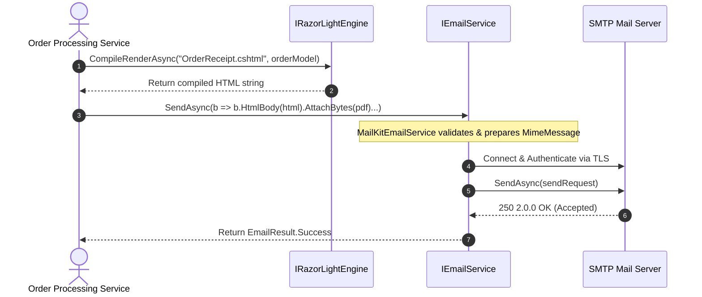

# RazorLight Template Guide

This guide details how to render dynamic `.cshtml` email views using **RazorLight** in your client application and deliver them with **AmtStudio.CustomMailingKit**.

---

## 🎯 Architecture Flow



---

## 📁 Recommended Client Project Structure

```
MyProject.Web/
├── Controllers/
│   └── OrderController.cs
├── Services/
│   └── OrderEmailSender.cs
├── Models/
│   └── OrderReceiptEmailModel.cs
└── EmailTemplates/
    ├── _Layout.cshtml              <-- Optional shared email layout
    └── OrderReceipt.cshtml         <-- Target email template
```

---

## 1. Install RazorLight in Your Client App

```bash
dotnet add package RazorLight
dotnet add package AmtStudio.CustomMailingKit
```

---

## 2. Configure DI in `Program.cs`

Configure both `AmtStudio.CustomMailingKit` and `RazorLightEngine`:

```csharp
using System.IO;
using AmtStudio.CustomMailingKit.Extensions;
using RazorLight;

var builder = WebApplication.CreateBuilder(args);

// 1. Register AmtStudio.CustomMailingKit
builder.Services.AddCustomMailingKit(builder.Configuration);

// 2. Configure RazorLight to look inside the "EmailTemplates" folder
var templatesFolder = Path.Combine(builder.Environment.ContentRootPath, "EmailTemplates");

var razorEngine = new RazorLightEngineBuilder()
    .UseFileSystemProject(templatesFolder)
    .UseMemoryCachingProvider()
    .Build();

builder.Services.AddSingleton<IRazorLightEngine>(razorEngine);

// 3. Register your email application service
builder.Services.AddScoped<IOrderEmailSender, OrderEmailSender>();

var app = builder.Build();
app.Run();
```

> [!TIP]
> To ensure your `.cshtml` templates are always copied to the build directory, add this to your client project's `.csproj`:
> ```xml
> <ItemGroup>
>   <None Update="EmailTemplates\**\*.cshtml">
>     <CopyToOutputDirectory>PreserveNewest</CopyToOutputDirectory>
>   </None>
> </ItemGroup>
> ```

---

## 3. Create the Model and Template

### `Models/OrderReceiptEmailModel.cs`
```csharp
namespace MyProject.Web.Models;

public record OrderReceiptEmailModel
{
    public required string OrderNumber { get; init; }
    public required string CustomerName { get; init; }
    public required string CustomerEmail { get; init; }
    public required DateTime OrderDate { get; init; }
    public required decimal TotalAmount { get; init; }
    public required List<OrderItem> Items { get; init; }
}

public record OrderItem(string Name, int Quantity, decimal Price);
```

### `EmailTemplates/OrderReceipt.cshtml`
```html
@using MyProject.Web.Models
@model OrderReceiptEmailModel

<!DOCTYPE html>
<html>
<head>
    <meta charset="utf-8">
    <style>
        body { font-family: -apple-system, BlinkMacSystemFont, 'Segoe UI', Roboto, Helvetica, Arial, sans-serif; background-color: #f7f9fc; margin: 0; padding: 20px; }
        .card { background: #ffffff; max-width: 580px; margin: 0 auto; border-radius: 8px; padding: 32px; border: 1px solid #e2e8f0; }
        .header { border-bottom: 2px solid #1a73e8; padding-bottom: 16px; margin-bottom: 24px; }
        .title { color: #1a73e8; margin: 0; font-size: 22px; font-weight: 700; }
        table { width: 100%; border-collapse: collapse; margin-top: 16px; }
        th { text-align: left; padding: 10px 8px; border-bottom: 1px solid #e2e8f0; color: #64748b; font-size: 13px; text-transform: uppercase; }
        td { padding: 12px 8px; border-bottom: 1px solid #f1f5f9; color: #1e293b; font-size: 14px; }
        .total-row td { font-weight: 700; font-size: 16px; color: #0f172a; border-top: 2px solid #e2e8f0; }
        .footer { font-size: 12px; color: #94a3b8; text-align: center; margin-top: 24px; }
    </style>
</head>
<body>
    <div class="card">
        <div class="header">
            <h1 class="title">Order Receipt #@Model.OrderNumber</h1>
        </div>

        <p>Dear <strong>@Model.CustomerName</strong>,</p>
        <p>Thank you for your purchase! We are processing your order:</p>

        <table>
            <thead>
                <tr>
                    <th>Item</th>
                    <th>Qty</th>
                    <th style="text-align: right;">Price</th>
                </tr>
            </thead>
            <tbody>
                @foreach (var item in Model.Items)
                {
                    <tr>
                        <td>@item.Name</td>
                        <td>@item.Quantity</td>
                        <td style="text-align: right;">@item.Price.ToString("C")</td>
                    </tr>
                }
                <tr class="total-row">
                    <td colspan="2">Total Paid</td>
                    <td style="text-align: right;">@Model.TotalAmount.ToString("C")</td>
                </tr>
            </tbody>
        </table>

        <div class="footer">
            <p>If you have any questions, reply directly to this email.</p>
        </div>
    </div>
</body>
</html>
```

---

## 4. Render and Deliver via MailingKit

```csharp
using AmtStudio.CustomMailingKit.Abstractions;
using AmtStudio.CustomMailingKit.Models;
using MyProject.Web.Models;
using RazorLight;

namespace MyProject.Web.Services;

public interface IOrderEmailSender
{
    Task<EmailResult> SendReceiptAsync(OrderReceiptEmailModel orderModel, byte[]? invoicePdf = null);
}

public class OrderEmailSender(
    IRazorLightEngine razorLight,
    IEmailService emailService,
    ILogger<OrderEmailSender> logger) : IOrderEmailSender
{
    public async Task<EmailResult> SendReceiptAsync(OrderReceiptEmailModel orderModel, byte[]? invoicePdf = null)
    {
        // 1. Render the Razor template to an HTML string
        string htmlBody = await razorLight.CompileRenderAsync("OrderReceipt.cshtml", orderModel);

        // 2. Deliver via AmtStudio.CustomMailingKit
        var result = await emailService.SendAsync(builder =>
        {
            builder
                .To(orderModel.CustomerEmail, orderModel.CustomerName)
                .Subject($"Your Receipt for Order #{orderModel.OrderNumber}")
                .HtmlBody(htmlBody)
                .Priority(EmailPriority.High);

            // Optional: attach PDF invoice
            if (invoicePdf is not null)
            {
                builder.AttachBytes(invoicePdf, $"Invoice-{orderModel.OrderNumber}.pdf", "application/pdf");
            }
        });

        if (result.IsSuccess)
        {
            logger.LogInformation("Receipt for Order {OrderNumber} delivered to {Email}",
                orderModel.OrderNumber, orderModel.CustomerEmail);
        }
        else
        {
            logger.LogError("Failed to deliver receipt for Order {OrderNumber}: {Error}",
                orderModel.OrderNumber, result.ErrorMessage);
        }

        return result;
    }
}
```
